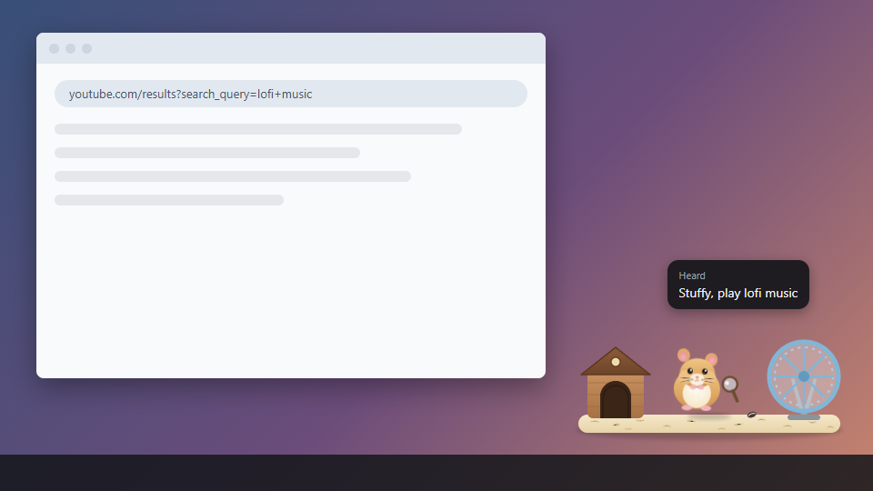
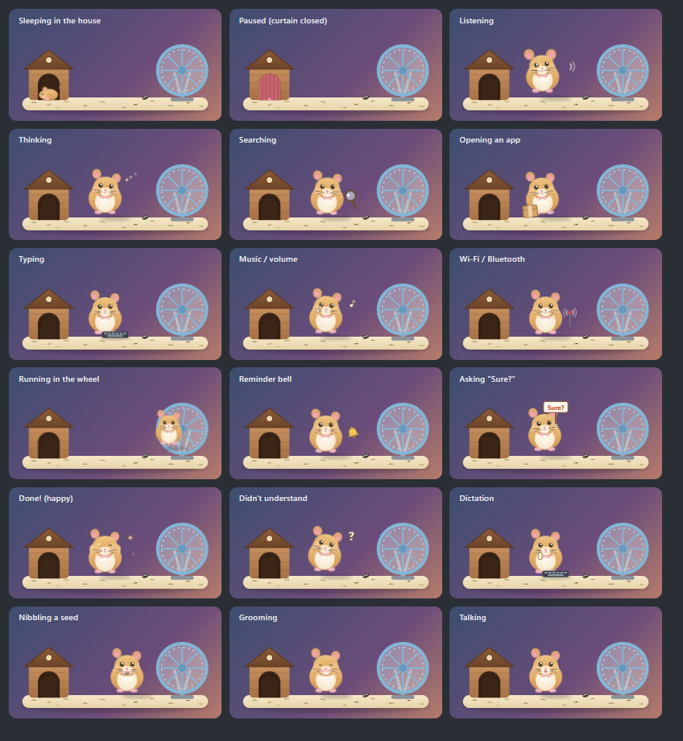
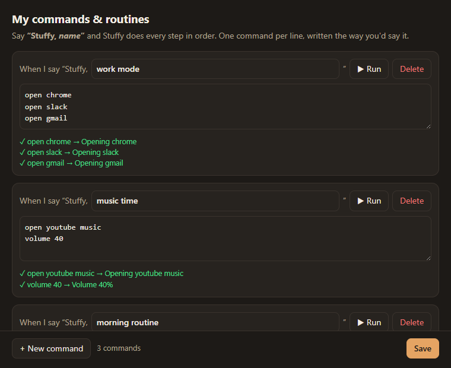

# Stuffy — a voice assistant hamster for Windows

**Talk to your PC.** Say **"Stuffy, open YouTube"**, **"Stuffy, volume 50"** or
**"Stuffy, remind me in 20 minutes to call mom"**, and a tiny animated hamster on your screen does it.

100 % local: no account, no cloud and no AI chatbot. Your voice never leaves your computer.


<p align="center">
  <a href="https://github.com/tellapriyatham05/stuffy-voice-assistant/releases/latest"><b>⬇️ Download Stuffy for Windows</b></a>
  &nbsp;·&nbsp; <a href="docs/USER_GUIDE.md"><b>📖 User Guide</b></a>
  &nbsp;·&nbsp; <a href="docs/VOICE_COMMANDS.md"><b>📋 Voice Command Cheat Sheet</b></a>
</p>

---

## Install in 3 steps

1. **Download** `Stuffy-Setup-2.0.0.exe` from the [Releases page](https://github.com/tellapriyatham05/stuffy-voice-assistant/releases/latest).
2. **Double-click it.** It installs and starts by itself.
   *(Blue "Windows protected your PC" box? Click **More info → Run anyway**.)*
3. **Allow the microphone** if Windows asks. Then say **"Stuffy, what time is it?"** 🎉

Stuffy now starts with Windows automatically. Full details and fixes are in the **[User Guide](docs/USER_GUIDE.md)**.

**Needs:** Windows 10/11 64-bit · any microphone · ~1.5 GB free space · 8 GB RAM recommended.

---

## What it can do

| | Say "Stuffy, …" |
|---|---|
| 🚀 Open any app, folder or Windows setting | "open Spotify" · "open Downloads" · "open Bluetooth settings" |
| 🌐 Open 40+ websites and search anywhere | "open Instagram" · "search shoes on Amazon" · "play Believer" |
| 🗂️ Browser tabs and windows | "new tab" · "tab 3" · "snap left" · "full screen" · "close Chrome" |
| ⌨️ Type, press keys, dictate | "type see you soon and enter" · "press ctrl shift t" · "start dictation" |
| 🖱️ Click buttons by name or number | "click Subscribe" · "show numbers" → "click 7" |
| 🔊 Volume, brightness, media | "volume 40" · "mute" · "brightness 70" · "next song" |
| 📶 Wi-Fi and Bluetooth | "Bluetooth on" · "wifi off" |
| ⏰ Timers and reminders | "timer 10 minutes" · "remind me at 6 pm to go to the gym" |
| ✅ [Focus Dot](https://github.com/tellapriyatham05/focus-dot) tasks | "add Q1 task pay rent" · "what are my tasks" |
| 🔁 Your own commands and routines | "start recording" … "save as morning routine" · "work mode" |
| 🖼️ Wallpaper, screenshots | "change wallpaper" · "take a screenshot" |
| 🔒 Lock, sleep, restart, shut down | "lock" · "restart" *(asks "Are you sure?" first)* |
| 🙈 Hide the hamster (still listening) | "hide" · "come back" |

➡️ **Every command, with all the ways to say it: [Voice Command Cheat Sheet](docs/VOICE_COMMANDS.md)**

### Shortcuts

| | |
|---|---|
| **Ctrl + Alt + S** | Listen now (same as saying "Stuffy"). Falls back to Ctrl + Shift + Alt + S or F9 if taken. |
| **Click the hamster** | Listen now |
| **Right-click the hamster** / tray icon | Menu: hide, pause, language, voice, browser, my commands, log, quit |
| **Drag the hamster** | Move it anywhere |

---

## Screenshots

**Stuffy on your desktop.** It sits in a corner (or wherever you drag it) and shows what it heard:



**Stuffy's moods.** The hamster shows what it's doing:



**Your own commands.** Make one name run many steps:



---

## How it works

```
microphone (renderer/overlay.js)
  → engine.js            Silero VAD cuts speech into sentences; Whisper tiny.en reads each one (~0.2 s);
                         Whisper small re-reads it when exact words matter (typing, search, dictation)
  → brain/assistant.js   wake word → listening → command → (confirm / pick a number / dictate / name a routine)
  → brain/parser.js      sentence → actions (plain rules, unit-tested, no AI)
  → system/executor.js   actions → Windows (system/helper.ps1: keys, UI Automation clicks, volume,
                         radios, wallpaper) · Focus Dot (system/focusdot.js) · timers (brain/timers.js)
  → voice.js             Kokoro "Sky" voice, pitched up for the hamster; mic ignored while it talks
  → renderer/hamster/    the hamster (habitat.svg + stuffy.css animations + stuffy.js behaviour)
```

Built with Electron and [sherpa-onnx](https://github.com/k2-fsa/sherpa-onnx). All speech models run offline on the CPU.

### Project layout

| Folder / file | What's inside |
|---|---|
| `main.js` | App start, tray menu, hotkey, windows, settings |
| `engine.js` | Speech recognition worker (VAD + Whisper) |
| `voice.js` | Text-to-speech (Kokoro) |
| `brain/` | `parser.js` (commands), `assistant.js` (conversation flow), `timers.js` |
| `system/` | `executor.js` (does the actions), `helper.ps1` (Windows bridge), `clicker.js`, `focusdot.js`, `autostart.js` |
| `renderer/` | Hamster overlay, numbers layer, commands editor |
| `tests/` | Parser, timer, voice and on-screen tests |
| `scripts/` | Hamster build, icon, screenshot rendering |
| `docs/` | User guide, cheat sheet, screenshots |

---

## For developers

### 1. Get the code and libraries

```bash
git clone https://github.com/tellapriyatham05/stuffy-voice-assistant.git
cd stuffy-voice-assistant
npm install
```

### 2. Download the speech models into `models/`

The models are too big for git (~820 MB), so download them from the sherpa-onnx releases:

| Put this in `models/` | From |
|---|---|
| `silero_vad.onnx` | [asr-models → silero_vad.onnx](https://github.com/k2-fsa/sherpa-onnx/releases/tag/asr-models) |
| `tiny.en-encoder.int8.onnx`, `tiny.en-decoder.int8.onnx`, `tiny.en-tokens.txt` | `sherpa-onnx-whisper-tiny.en.tar.bz2` (same page) |
| `small-encoder.int8.onnx`, `small-decoder.int8.onnx`, `small-tokens.txt` | `sherpa-onnx-whisper-small.tar.bz2` (same page) |
| `kokoro/` (`model.onnx`, `voices.bin`, `tokens.txt`, `lexicon-us-en.txt`, `espeak-ng-data/`) | `kokoro-multi-lang-v1_0.tar.bz2` from [tts-models](https://github.com/k2-fsa/sherpa-onnx/releases/tag/tts-models) |

### 3. Run, test, build

```bash
npm start                      # run from source
npm test                       # parser + timers/dictation unit tests
npm run test:voice             # recorded-voice checks through the real app (dry run)
npm run test:actions           # on-screen checks (types/clicks only in its own test window)
npm run dist                   # build dist/Stuffy Setup 2.0.0.exe (bundles the models)
npx electron scripts/make-screenshots.js   # re-render docs/screenshots
```

The installed app registers two Windows scheduled tasks, **Stuffy - start at login** and
**Stuffy - keep running** (every 5 minutes; does nothing if Stuffy is already running or you chose Quit).

User data lives in `%APPDATA%\stuffy`: `settings.json`, `custom-commands.json`, timers and `stuffy.log`.

---

## License

[MIT](LICENSE). Free to use, change and share.

Speech models belong to their authors: Whisper (MIT, OpenAI), Silero VAD (MIT), Kokoro (Apache-2.0).
